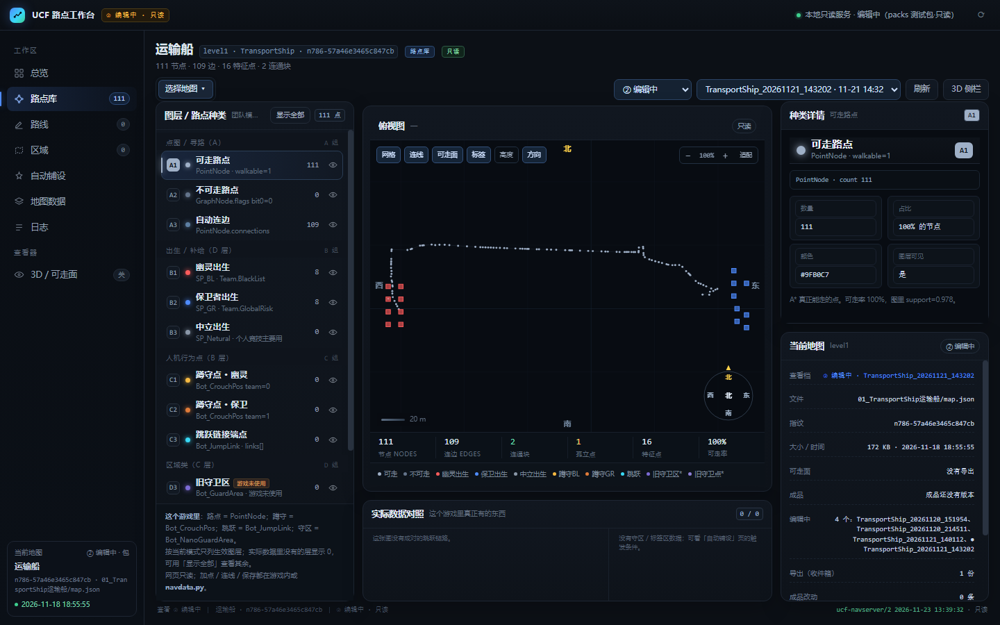
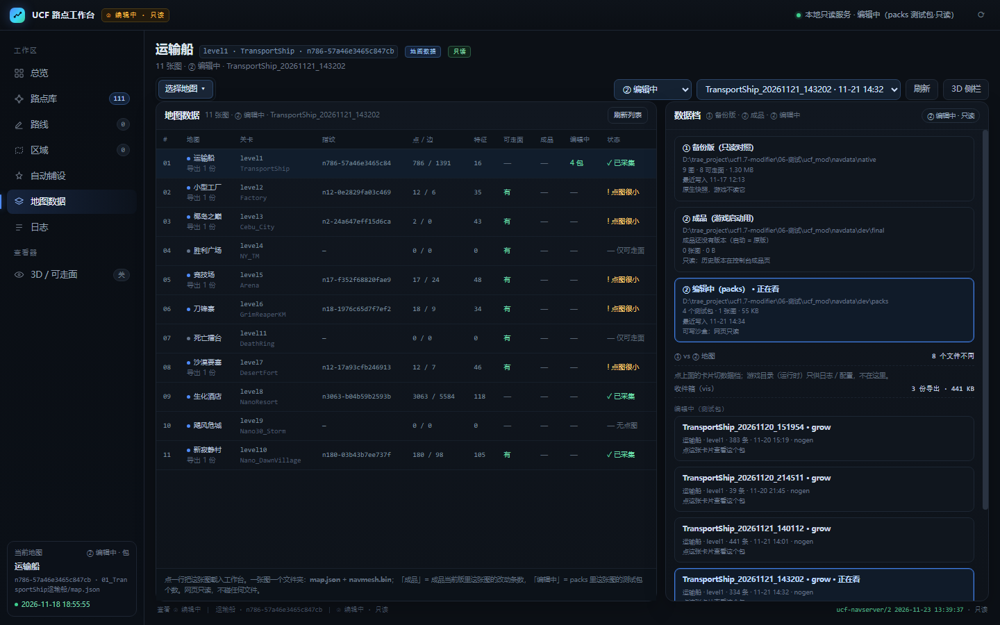

# 工作台数据档：① 备份版 / ② 成品 / ② 编辑中（2026-11-23）

## 一、需求

- 工作台顶栏还是旧的三档 **① 备份版 / ② 开发版 / ③ 部署版**。③ 从 2026-11-21 起已经不放导航数据，
  切过去是空的，看着像坏了。
- 控制台「人机路点」已经分成 **编辑中 / 成品** 两档；工作台只在总览里显示「4 包 / 0 版」几个数字，
  不能按包、按成品版本看画布。
- 用户决定：
  - ① 备份版保留为**对照**；
  - 成品**本期只看当前启动版**（历史版本 / 对比留在控制台）；
  - 默认档**记住上次**；
  - 指纹失效的旧包**列出来但标红禁用**；
  - 顶栏选项直接换成 **① 备份版 / ② 成品 / ② 编辑中**。

## 二、界面

顶栏右侧是一个下拉 + 编辑中时多一个包下拉：

```text
[② 编辑中 ▾]  [TransportShip_20261121_143202 · 11-21 14:32 ▾]  [刷新] [3D 侧栏]
```

| 档位 | 读什么 | 二级选择 | 空态 |
| --- | --- | --- | --- |
| ① 备份版 | `navdata\native\<图>\` | 无 | 原生冻结快照；没有编辑 |
| ② 成品 | `navdata\dev\<图>\` + `final\<当前版本>\<指纹>.txt` | 无（只看当前版） | 成品 0 版：琥珀色「还没有版本（启动 = 原版）」；画布显示基准点图 |
| ② 编辑中 | `navdata\dev\<图>\` + `packs\<图>\<包>\<指纹>.txt` | 当前图的包，默认最新 | 「这张图还没有包」；包全失效时提示重新扫图 / 新建包 |

- 成品档在包下拉的位置显示一个 chip：`当前版 <版本名> · 时间 · 张数`，没有版本时是琥珀色提示。
- 编辑中档只列当前地图的包；指纹对不上的旧包排在最后、禁用、标「✖ 指纹失效」，不会套到画布。
- 切档 / 切包只改内存里「读哪一份」，不写 `_current.txt`、不写 packs。
- 默认档：成品有当前版看成品，否则有包看编辑中；之后按 localStorage 记住上次。
- 旧深链接 `?profile=dev|deploy` 落成品、`?profile=test|export` 落编辑中，并提示一句；新链接是
  `?view=pack&map=<图>/map.json&pack=<图>/<包>`。

## 三、渲染对齐（不修就会显示错）

工作台 / 3D 原来只认 `blank`，而运输船 4 个包全是 `grow`。只换下拉、直接套包会把
原生 786 点 + 新点一起画出来（151954 那个包会变 982 点），游戏里其实只有新点。

这次补了三件事：

1. **`grow` / `blank`**：原生点全禁、原生边全断，再按清单 `node add` / `edge add` 重建；
   **`keep`**：原生点保留，只加增量。与 `src/editor.c` 的 `nav_apply_grow` 一致。
2. **`jump add`**：测试包 / 成品清单里的手工跳链要进路线页和 3D（来源标「清单 jump add」）。
3. **`edge addout / addin / delout / delin`**：2D 不画方向，按一条边显示 / 删除，至少不漏。

改完后工作台显示的点数与游戏清单一致：

| 包 | 类型 | 工作台点数 |
| --- | --- | --- |
| TransportShip_20261120_151954 | grow | **196** |
| TransportShip_20261120_214511 | grow | **27** |
| TransportShip_20261121_140112 | grow | **151** |
| TransportShip_20261121_143202 | grow | **111** |

（边数是清单里的唯一有效边；同一对点重复 add 会去重，端点不存在的 add 会跳过，所以不等于
`edge add` 行数。）

## 四、验证

- 服务端：`/api/profile?set=native|final|pack`；旧 `deploy` 落成品并返回提示；
  `/api/workbench` 不再有 `versions.deploy`，`packs` 带 `grow/keep/fp/full`。
- 浏览器（headless Chrome + CDP）实际切档、切包：
  - 成品（0 版）→ 786 点，chip 显示「还没有版本」；
  - 备份 → 786 点，chip / 包下拉隐藏；
  - 编辑中 143202 → 111 点；切 151954 → 196 点，URL 里的 `view/pack/map` 同步；
  - 切到没有包的小型工厂 → 包下拉禁用「这张图还没有包」，画布 12 点；
  - 3D 侧栏 iframe 跟着切：143202 → 111，151954 → 196。
- 临时造了一个 `final\zz_test_view`（复制 143202 的 txt）验证成品档：显示当前版 chip、111 点；
  **验证后已删除**，成品恢复 0 版。
- 切档前后 `final\_current.txt` / `_index.json` / 143202 的 txt 的 mtime 完全没变：`/api/profile`
  只改服务内存里的全局变量，不写任何数据文件。
- 静态：`python tools/test_workbench_views.py`、`test_blank_pack.py` 通过；`navserver.py` 可编译。

截图：





## 五、改动文件

- `workbench/nav-studio.html` —— 顶栏下拉 / 包下拉 / 成品 chip；静态文案。
- `workbench/nav-studio.css` —— 包下拉、成品 chip、失效包样式、窄屏换行。
- `workbench/nav-studio-app.js` —— 三档状态、包选择、URL、总览 / 地图数据页 / 提示 / 3D URL；
  `applyTxt` 补 grow / keep / jump / 单向边。
- `tools/navserver.py` —— `native/final/pack` 档位、旧别名、默认档、`packs` 元数据、
  `final.path`、事件标签；移除 `versions.deploy` 和每图的 deploy 字段。
- `tools/navview.html` —— 下拉 / 帮助、grow / jump / 单向边、`?profile=final|pack|native`。
- `tools/test_workbench_views.py` —— 新增静态自检。
- `workbench/README.md` —— 数据档说明、深链接、更新记录。

数据文件：**没有改**。临时成品版本 `zz_test_view` 已删除。

## 六、已知边界

- 工作台成品档只看**当前**启动版；历史版本 / 版本对比在控制台成品页（用户本期选择）。
- 查看档仍是服务内存里的全局状态（单机单窗口）；多个标签页会互相影响，沿用旧行为。
- 2D 图不画单向箭头；`edge out/in` 只按无向边显示 / 删除，计数按唯一边。
- 3D 的贴图 / 地形是新功能，不在本次改动范围；只保证路点、可走面、跳链跟着数据档走。
