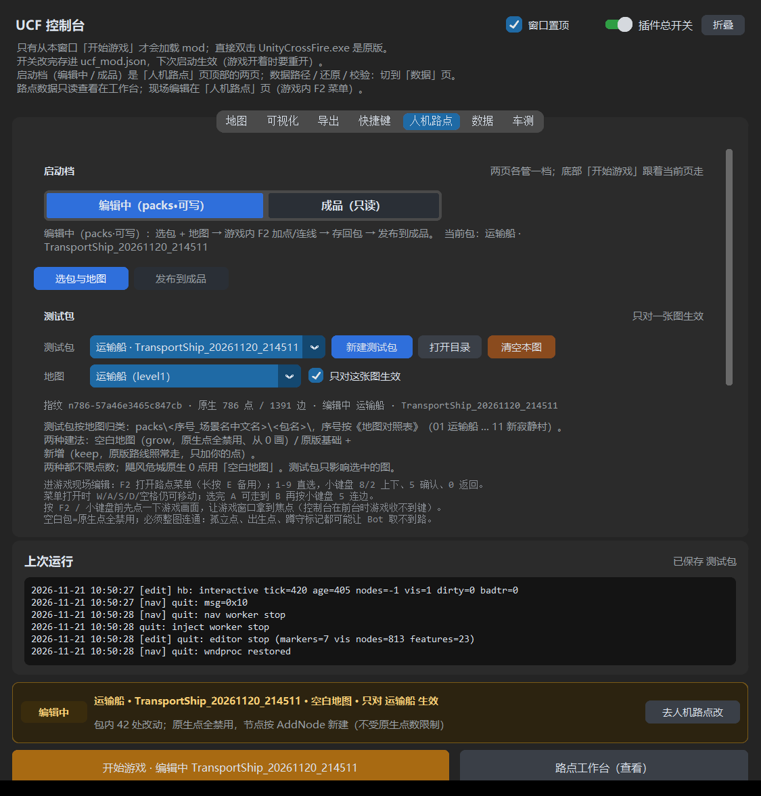
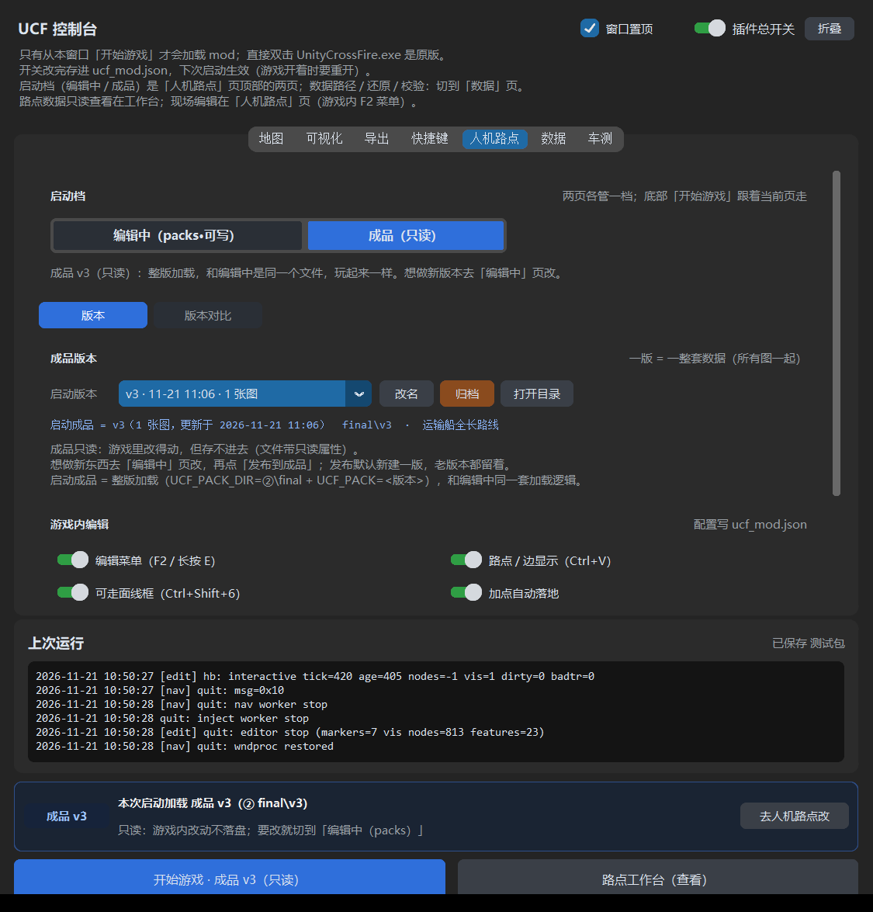
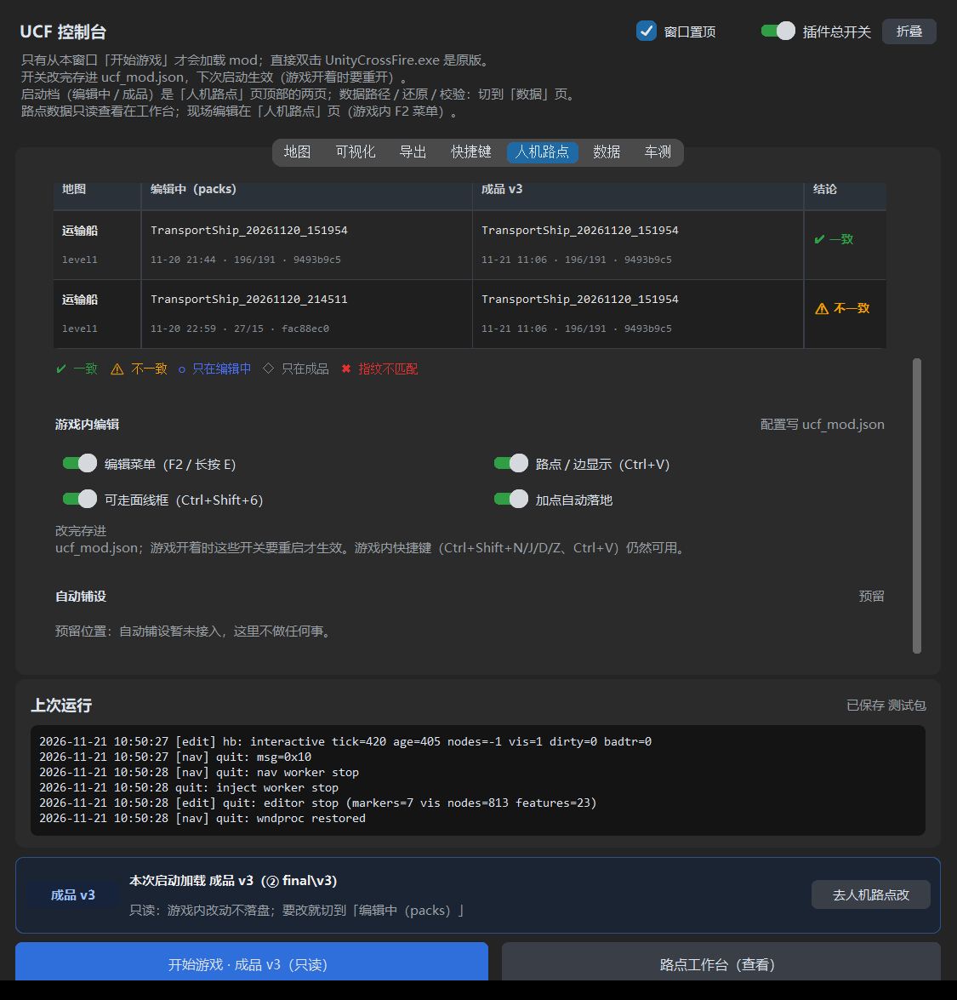
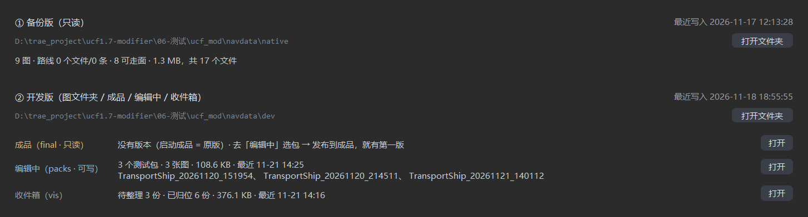

# 成品多版本 + 按包启动：编辑中发布过去，玩起来一模一样（2026-11-21）

## 一、两条需求

1. **这软件要发给不会开发、不会用 AI 的普通人**：编辑中做完，点一个按钮进成品，
   点「开始游戏」就能用，**效果和编辑中一模一样**。
2. **成品要能并存多个版本**：发布不能把上一版覆盖掉，启动时由用户选玩哪一版。

## 二、为什么原来做不到

| 事实 | 证据 |
| --- | --- |
| 现存包都是「空白地图」(grow)：运输船 196 点 / 27 点 | `navdata\dev\packs\01_TransportShip运输船\*` |
| 成品档（非测试包）进图直接把 `grow`/`keep` 标记清掉 | `editor.c:5974` → `ignore blank/grow/keep (only a test pack may replace the base)` |
| 成品档加点只能借「已经不可走的空槽位」 | `editor.c:4745`（`nav_apply_core` 第 4 步） |
| 运输船 786 个原生点**全部可走**，一个空槽都没有 | `navdata\dev\01_TransportShip运输船\map.json` 里 `walk` 全是 1 |
| 真正要的「禁用全部原生点 + AddNode 新建」只在测试包分支 | `editor.c:3990 / 4694 / 4763` 都带 `&& g_packName[0]` |
| 成品原来只有一份：`dev\nav\<指纹>.txt`，发布 = 覆盖 | `navdata.py` 旧 `cmd_pack_promote` |

结论：不放开 C 侧，grow/keep 发布进成品后 **0 条生效**；而且一张图只能存一份。

## 三、改法（不碰建点逻辑、DLL 不用重编）

### 1) 成品「按包启动」

插件读数据的规则只有一条：`<包根>\<包名>\<指纹>.txt`（`editor.c:5769`）。所以成品档
不再走「正式版路径」，而是让控制台这样启动：

```
成品     UCF_PACK_DIR=②\navdata\dev\final   UCF_PACK=<版本名>
编辑中   UCF_PACK_DIR=②\navdata\dev\packs   UCF_PACK=<图文件夹>\<包名>
原版     总开关关
```

成品和编辑中于是走**同一段代码**：grow / keep / 0 点图 / AddNode 建点全都照常。
发布就是把 `<指纹>.txt` 拷过去，连内容都不改 —— 实测两边 sha256 完全相同。

### 2) 成品多版本：一版 = 一整套数据

```
navdata\dev\final\
  <包名>\               每个版本一个目录（插件按 <包根>\<包名> 读它）
                        名字默认沿用测试包名，重名加 -2 / -3（旧数据仍叫 v1、v2）
    <指纹>.txt  nogen.txt
  _index.json            台账：每版创建时间 / 继承自哪版 / 备注 / 每图 sha、点边、来源包
  _current.txt           当前选中的版本
```

* 发布默认 **新建一版**：以当前版为底整套复制，再用这个包替换它那张图 → 老版本全留。
* **版本名默认沿用测试包名**（2026-11-21 起）：包 `TransportShip_20261120_214511`
  → `final\TransportShip_20261120_214511`；重名自动 `-2` / `-3`，老版本一个不覆盖。
  命令行想自己起名：`pack promote <包> --as <名字>`。
* 也可以 `--into <版本>`：只更新某一版里的那张图，版本名不变。
* 名字允许中文，挡掉空格和 `\ / : * ? " < > |`；发完也能 `final rename`
  （控制台下拉框旁边「改名」）。`seq` 只增不减，只给老成品迁移时编号（v1/v2/v3）。
* 删除 `final rm <版本>`（控制台成品页「删除」）：**真删** `final\<版本>\` 整个目录，
  删了找不回来；删到一版不剩也行（成品 = 没有版本 = 启动原版）。
  想留个后手：`final rm <版本> --keep`，挪进 `dev\archive\final_old\`（旧行为，控制台不用）。
* 2026-11-21 收尾：原来那两版（`v3`、`正式版A`）按用户要求直接删掉了，
  成品现在是**空的**（`_index.json` 里 `versions: []`、`current: ""`），
  下次「发布到成品」就会按包名建第一版。
* 老成品目录 `dev\nav\` 首次运行会自动搬成 v1，搬完清空旧址。

### 3) 只读

成品文件全部带 Windows 只读属性：游戏内保存 `fopen(path,"w")` 直接失败
（`editor.c:4238` 只打一行日志），没改动的空保存走 `DeleteFileA` 也会失败。
控制台每次启动前 `prepare_final_dir(版本)` 重设一遍；`pack promote` 覆盖前先去属性。

## 四、界面（人机路点页：两页 + 页内标签）

2026-11-21 用户要求：成品和编辑中的内容分开成两页，页内再用标签切换
（原来两档挤在同一张 ① 卡里换下拉，看不出是换页）。

```text
「人机路点」页
├─ 启动档：[编辑中（packs·可写）] [成品（只读）]     ← 整页切换，底部「开始游戏」跟着走
├─ 编辑中页  标签 [选包与地图] [发布到成品]
└─ 成品页    标签 [版本] [版本对比]
```

* 编辑中页「选包与地图」：测试包下拉（新建测试包 / 打开目录 / 清空本图）+ 地图下拉 +
  「只对这张图生效」+ 指纹与原生点边计数行 + F2 菜单操作说明。
* 编辑中页「发布到成品」：绿色发布按钮 + 说明（新建一版、版本名沿用测试包名，老版本全留着）。
* 成品页「版本」：启动版本下拉 `TransportShip_20261120_214511 · 11-21 11:06 · 1 张图` +
  改名 / 打开目录 / 删除（红色，二次确认，真删目录）+
  只读说明。选中的版本记进台账，下次启动还是它。
* 成品页「版本对比」：**表格**，左右并排同一行：

  | 地图 | 编辑中（packs） | 成品 <版本名> | 结论 |
  | --- | --- | --- | --- |
  | 运输船 / level1 | 包名 · 时间 · 点/边 · sha8 | 包名 · 时间 · 点/边 · sha8 | ✔ 一致 |

  行底色隔行区分，结论列上色（判据与徽标见下表）。表格下面是图例。

  | 徽标 | 颜色 | 判据 |
  | --- | --- | --- |
  | ✔ 一致 | 绿 | 两边 sha256 相同（同一个文件，玩起来一样） |
  | ⚠ 不一致 | 黄 | 两边都有，sha 不同 |
  | ○ 待发布 | 蓝 | 成品这一版里没有这张图 |
  | ◇ 只在成品 | 灰 | 成品里有，但没有包对应它（来源包已删/已归档） |
  | ✖ 指纹失效 | 红 | 包里的指纹不在当前地图表里（这张图改过，包作废） |

截图（2026-11-21）：







（这三张图是 2026-11-21 早些时候抓的，当时成品版本还叫 `v3`；
现在版本名默认沿用测试包名，界面布局不变，只是那个位置显示 `TransportShip_20261120_214511` 这样的名字。）

### 切页卡顿（2026-11-21 修复）

* 现象：点「编辑中 / 成品」明显顿一下（实测一次切换 700–850 ms）。
* 原因：`game_running()` 走 `tasklist` 子进程（约 330 ms），而一次切页被调了两次
  （`persist` 一次、`refresh_launch_strip` 一次）；另外 4 s 的状态定时器也在调它，
  所以就算不切页、不开游戏，也会每 4 秒顿一下。对比表每次切换都整个重建（约 39 ms）也是白花。
* 修法：`game_running()` 改用 `CreateToolhelp32Snapshot` 直接枚举进程（ctypes，约 6 ms），
  外面套 1 s 缓存；`kill_game()` 轮询用 `fresh=True` 绕过缓存，等游戏退出不受影响。
  对比表不可见时只记 `_cmp_dirty`，等切到「版本对比」标签（或回到成品页时它正开着）再重建。
* 结果：切页 850 ms → 10–60 ms（含重绘）；4 s 定时器 330 ms → 6 ms。

## 五、代价 / 已知瑕疵

* 插件日志和 HUD 把成品显示成「数据 测试包 <版本名>」（`pack_stat` 按 `g_packName` 拼字）。
  现在版本名就是测试包名，看着已经对得上，只是「成品」二字还写成「测试包」；
  真要改得动 C 的字符串再重编，暂不处理。
* `UCF_NAV_READONLY=1` 在包模式下不生效（`editor.c:4228` 有 `&& !g_packName[0]`），
  只读靠文件属性兜底。将来若重编 DLL，把那一行改成只判 `g_navReadOnly` 更干净。

## 六、验收步骤（人工）

1. 编辑中选一个包 →「发布到成品」→ 新建一版：弹窗里那行写「新建一版的版本名 = <包名>」。
2. 启动档切到「成品」页 → 版本下拉选刚发布那版 → 开始游戏，跑同一张图。
3. 对照 `ucf_mod.log` 里的 `naved: grow: N native disabled, M new nodes, ...` 和编辑中是否一致。
4. 同一个包再发一次 → 版本名变 `<包名>-2`（老版本还在，能切回去）；或用「更新当前版」只改它、名字不变。

## 七、改动文件

* `tools/navdata.py` —— 成品多版本：`FINAL_ROOT/_index.json/_current.txt`、
  `final_versions/final_current/final_new_version/final_ensure_root`、
  `final list|use|rename|rm`（rm 真删，`--keep` 才归档）、
  `pack promote --into/--note/--as`、`pack compare`；
  `final_name_from_pack/final_unique_name`（版本名沿用测试包名，重名 -2 / -3）
* `tools/控制台.pyw` —— 启动档两页（编辑中 / 成品）+ 页内标签、
  成品版本下拉 + 改名/打开目录/删除、发布弹窗（新建一版/更新当前版 + 备注）、
  「版本对比」表格、`game_env()` 成品分支、`prepare_final_dir(版本)`、
  数据页 ② 卡拆成 成品 / 编辑中 / 收件箱 三行（`refresh_dev_rows()`）
* `tools/ucf_paths.py` —— `FINAL` 常量 + 三档说明
* `tools/navserver.py` —— 网页端「nav」看的是当前成品版本目录
* `src/editor.c` —— 只改注释，**DLL 未重编**
* `README.md` / `docs/record/三版数据与路径_2026-11-17.md` —— 三档表

## 八、数据页 ② 卡拆成三块（2026-11-21）

* 原来 ② 开发版只有一行汇总：「9 图 · 编辑 1 个文件/0 条 · 8 可走面 · 1.8 MB，共 39 个文件」，
  再加一行「收件箱：导出 9 份 · …」。成品、编辑中、收件箱的数字挤在一起，
  看的人分不清哪个数属于哪块（「9 图」是 `maps\` 的、「8 可走面」是 `vis\` 的）。
* 现在 ② 卡里三行分开，各走各的统计：

  ```text
  成品（final · 只读）    2 个版本 · 当前 TransportShip_20261120_214511 · 9 张图 · 1.8 MB · 最近 11-21 10:41
  编辑中（packs · 可写）  2 个测试包 · 2 张图 · 88.0 KB · 最近 11-20 22:59
                          TransportShip_20261120_151954、TransportShip_20261120_214511
  收件箱（vis）           导出 9 份 · 可走面 8 份 · 918.9 KB · 最近 11-21 09:47
  ```

* 数都按块算：成品数版本目录里几张图（当前版）+ 所有版本占多大；
  编辑中数 `packs\<地图>\<包>\<指纹>.txt` 和包名；收件箱只数 `vis\` 的导出与 `navmesh_*.bin`。
* 每行右边有自己的「打开」按钮：成品 → `final\`、编辑中 → `packs\`、收件箱 → `vis\`，
  不用先开 ② 根目录再往下点。目录不存在只提示，不替你创建。
* 换行宽度跟着窗口走：行框 `<Configure>` 里重算 `wraplength = 行宽 - 260`
  （148 给左边标签、66 给「打开」、46 留余量）——窗口拉宽一行就放得下，缩窄也不会把字截掉。
* 时间统一 `MM-DD HH:MM`（`fmt_short`），日期和时间之间用不换行空格——Tk 只在空格断行，
  窄窗口下不会把时间甩到下一行只剩「11-21 10:41」。
* 新增 `dir_bytes()`：递归数任意目录的 (字节数, 最新写入时间)；
  `dir_stats()` 只数 `maps/nav/vis`，`final\`、`packs\` 不在里面。
* 成品没有版本时那一行直接写「没有版本（启动成品 = 原版）· 去「编辑中」选包 → 发布到成品，就有第一版」。

  

  截图是 2026-11-21 晚真实状态：成品里 `v3` / `正式版A` 已删，所以「成品」那行是空的；
  有版本时会写成「2 个版本 · 当前 <版本名> · 9 张图 · 1.8 MB · 最近 11-21 10:41」。

