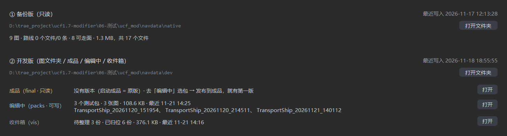

# 按地图分文件夹（2026-11-21）

> **类型：记（一次改造）**——① 备份 / ② 开发 从 `maps\ nav\ vis\` 三块平铺，改成「一张图一个文件夹」，
> 和 ② `packs\` 用同一套命名（出处仍是 [地图对照表](../guide/地图对照表.md)）。

## 一、为什么改

`packs\` 早就按图分了（`packs\01_TransportShip运输船\<包>\`），可 ① ② 里的点图、可走面、导出
还散在 `maps\` `nav\` `vis\` 三个目录：想看「运输船有哪些数据」，得在三个目录之间来回跳，
还得记住 `01_运输船.json`、`level1_运输船\`、`01_TransportShip运输船\` 其实是同一张图的三套写法。

现在一张图一个文件夹，点进去就是它的全部数据；不属于任何一张图的（对照表、清单、说明）统一进 `00_公共\`。

## 二、现在的样子

```
06-测试\ucf_mod\navdata\
├─ native\                          ① 备份（只读，冻结）
│  ├─ 00_公共\                       names.json / README.md / SHA256SUMS.txt / .frozen.json
│  ├─ 01_TransportShip运输船\         map.json
│  ├─ 02_Factory小型工厂\             map.json  navmesh.bin
│  ├─ 03_Cebu_City椰岛之巅\           map.json  navmesh.bin
│  ├─ 04_NY_TM胜利广场\               navmesh.bin      ← 原生没点图，只有可走面
│  ├─ 05_Arena竞技场\                 map.json  navmesh.bin
│  ├─ 06_GrimReaperKM刀锋寨\          map.json  navmesh.bin
│  ├─ 07_DeathRing死亡擂台\           navmesh.bin      ← 同上
│  ├─ 08_DesertFort沙漠要塞\          map.json  navmesh.bin
│  ├─ 09_NanoResort生化酒店\          map.json
│  ├─ 10_Nano30_Storm飓风危城\        map.json         ← 原生 0 点空档
│  └─ 11_Nano_DawnVillage新寂静村\    map.json  navmesh.bin
│
└─ dev\                             ② 开发（唯一数据源）
   ├─ 00_公共\                       names.json / _index.json / INDEX.md / nogen.txt
   ├─ 01_TransportShip运输船\
   │    map.json
   │    导出\20261117-135205_n786-57a46e3465c847cb.json
   ├─ …（04 / 07 只有 navmesh.bin；01 / 09 / 10 只有 map.json）
   ├─ packs\01_TransportShip运输船\<包>\   编辑中 —— 不动（本来就是 图\包）
   ├─ final\<版本>\<指纹>.txt               成品 —— 不动（一版一整套）
   ├─ archive\                             历史归档 —— 不动
   └─ vis\                                 收件箱 —— 插件临时落点，整理后进 <图>\导出\
```



## 三、搬了什么

| 原来 | 现在 | 数量 |
| --- | --- | --- |
| `native\maps\01_运输船.json` | `native\01_TransportShip运输船\map.json` | 9 |
| `native\vis\navmesh_nm840-….bin` | `native\02_Factory小型工厂\navmesh.bin` | 8 |
| `native\nav\names.json` | `native\00_公共\names.json` | 1 |
| `native\{README.md, SHA256SUMS.txt, .frozen.json}` | `native\00_公共\` | 3 |
| `dev\maps\*.json` | `dev\<图>\map.json` | 9 |
| `dev\vis\navmesh\*.bin` | `dev\<图>\navmesh.bin` | 8 |
| `dev\maps\{_index.json, INDEX.md}` | `dev\00_公共\` | 2 |
| `dev\nav\{names.json, nogen.txt}` | `dev\00_公共\` | 2 |
| `dev\vis\raw\level1_运输船\*.json` | `dev\<图>\导出\*.json` | 6 |

`map.json` / `navmesh.bin` 的内容**一个字节都没改**（搬前搬后逐个比 sha256）；
变的只有 `_index.json`、`.frozen.json`、`SHA256SUMS.txt`、`INDEX.md`、`README.md` 这些记路径的清单。

可走面顺手去掉了 `nm<顶点数>-<指纹>` 这种要查表才知道是哪张图的名字：文件夹名本身已经说明是哪张图，
原文件名记在 `.frozen.json` 的 `navmesh_origin` 里。

## 四、没动的

| 不动 | 原因 |
| --- | --- |
| `dev\packs\<图>\<包>` | 插件只认两级：`UCF_PACK_DIR=packs` + `UCF_PACK=<图>\<包>`，游戏里切包靠它；改三级要动 DLL |
| `dev\final\<版本>\<指纹>.txt` | 成品是「一版 = 一整套」，启动时整版读；插件按 `<版本>\<指纹>.txt` 找文件 |
| `dev\archive\` | 历史快照，只在回滚时用 |
| ③ 游戏目录 `ucf_mod\` | 2026-11-21 起只当运行环境，本来就不放数据 |

**DLL 没改、没重编**：插件读的还是 `UCF_PACK_DIR` + `UCF_PACK` + `<packdir>\<指纹>.txt`、`<g_dir>\nav\nogen.txt`，
这些都没变；变的只是 Python 工具怎么找「正式数据」。

## 五、代码改动

| 文件 | 改了什么 |
| --- | --- |
| `core\ucf_paths.py` | 新增图文件夹的唯一入口：`map_folder / map_dir / map_json / map_files / map_docs / navmesh_file / navmesh_files / route_files / names_path / index_path / common_dir / manifest_dir`；每个都兼容旧布局（`maps\*.json`） |
| `tools\_oneoff\migrate_map_folders.py` | **新增**：一次性搬家，`--dry` / `--apply` / `--undo`，每个文件搬前搬后比 sha256 |
| `core\navdata.py` | `freeze` 写 `<图>\map.json` + `navmesh.bin`；`restore` 按图文件夹镜像；`diff` 按相对路径比；`status` 报「图 / 可走面 / 路线」；`rebuild_index` 写 `00_公共\` |
| `console\navserver.py` | 图列表、索引、`navmesh_for`、`/api/raw`、`/api/txt`、版本统计、一致性全部走 ucf_paths |
| `console\控制台.pyw` | `load_maps` / `find_map_doc` / `dir_stats` / `data_counts` / `tree_hashes` / `latest_export` 改读图文件夹；收件箱那行改报「待整理 · 已归位」 |
| `tools\data\tidy_vis.py` | 整理目标从 `vis\raw\levelN_名\` 改成 `<图>\导出\`，可走面归 `<图>\navmesh.bin`，认不出的留收件箱 |
| `tools\data\organize_maps.py` | 整理结果直接写 `<图>\map.json`，索引 / `INDEX.md` 写 `00_公共\`，归档时连 `<图>\导出\` 一起收 |
| `tools\data\check_jumps.py`、`make_practice.py` | 跟着改路径（练习场放 `00_公共\00_练习场.json`） |
| `tests\test_mapfolders.py` | **新增**自检：9 图 / 8 面 / `00_公共` / 收件箱干净 / 四个读法数字一致 |
| `tests\test_blank_pack.py`、`test_console_packcmd.py` | 修两处过期断言（`is_grow → pack_flags`、`blank → grow`） |

## 六、迁移与回滚

```
cd tools
python migrate_map_folders.py            # 只看会搬什么
python migrate_map_folders.py --apply    # 真搬（sha256 逐个比对，不一致立刻停）
python migrate_map_folders.py --undo     # 按 navdata\_migrate_mapfolders_last.json 原路退回
```

搬家清单留在 `navdata\_migrate_mapfolders_<时间>.json`（每个文件的旧 / 新路径和 sha256），
元数据原件在 `navdata\_migrate_mapfolders_<时间>_meta\`；`navdata\` 本身也在 git 里，退不回去也能 `git restore`。

## 七、验证

| 检查 | 结果 |
| --- | --- |
| `python navdata.py verify` | OK：18 个文件，只读属性：是 |
| `python navdata.py diff` | 只在开发版 0 / 只在备份版 0（8 张图的出生点名早就改过，不是这次造成的） |
| `python test_mapfolders.py` | OK：9 图 / 8 面 / `00_公共` / 收件箱干净 / 四个读法数字一致 |
| `python tidy_vis.py --dry` | 没有要归位的（只剩 3 份认不出关卡的，留在收件箱） |
| 网页编辑器 `/api/maps`、`/api/studio`、`/api/raw` | 200；`/api/raw?dir=maps&file=01_TransportShip运输船/map.json` = 175724 字节，和文件一致 |
| 控制台「数据」页 | ① 9 图 · 8 可走面 · 17 个文件；② 成品 / 编辑中 / 收件箱三行照常 |

## 八、顺手修的

- ① 备份版 `.frozen.json` 里 level9 的中文名还是旧快照「暴风」，和文件夹、对照表不一致 → 改成「飓风危城」，README 重生成。
- `navdata.py diff` 以前把 `names.json`、`SHA256SUMS.txt` 也当路线文件算，会冒出「只在备份版：SHA256SUMS.txt」这种噪声 → 现在只认 `<指纹>.txt`。
- 网页编辑器找可走面不再靠「原生顶点数对号」猜文件名：文件夹里就是 `navmesh.bin`（旧布局仍保留顶点数回退）。
