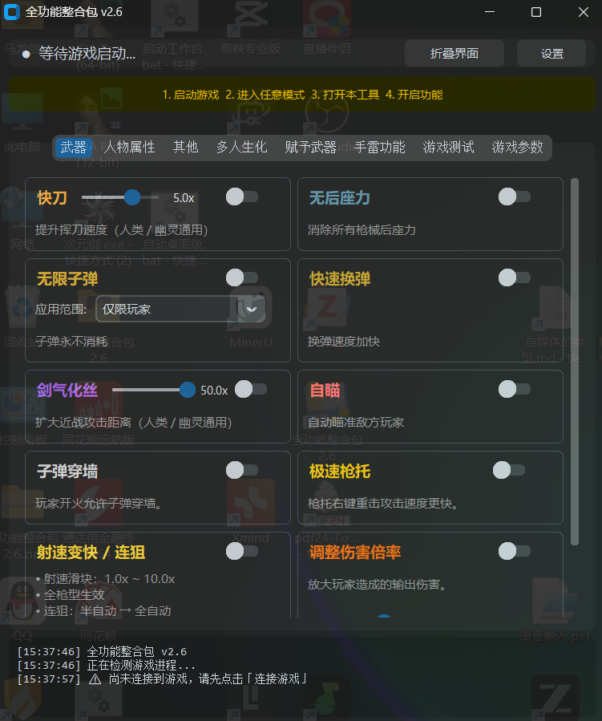
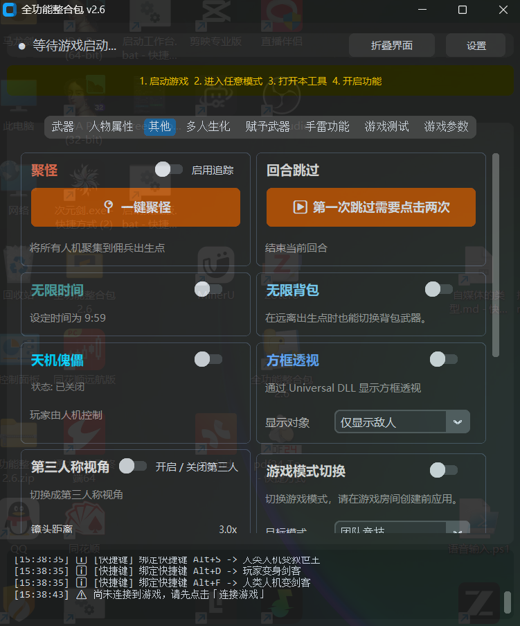
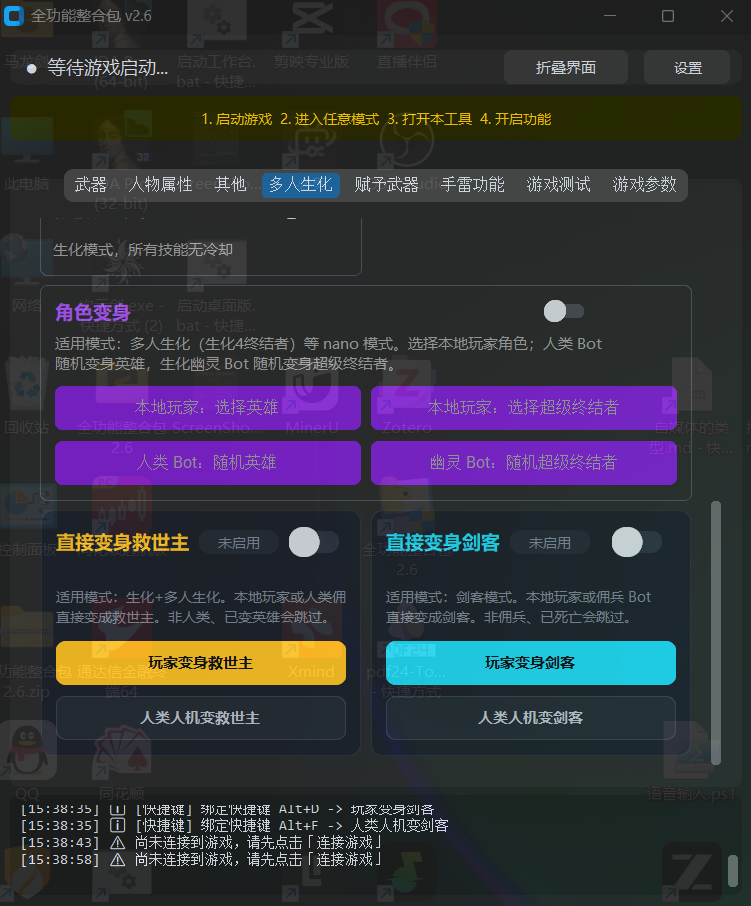
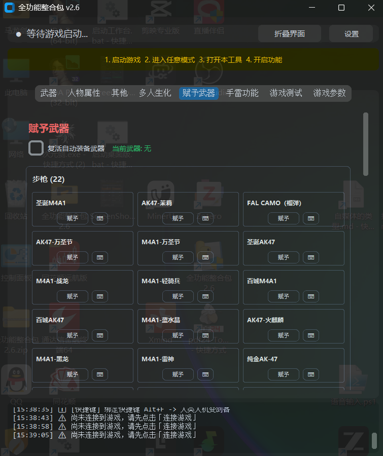
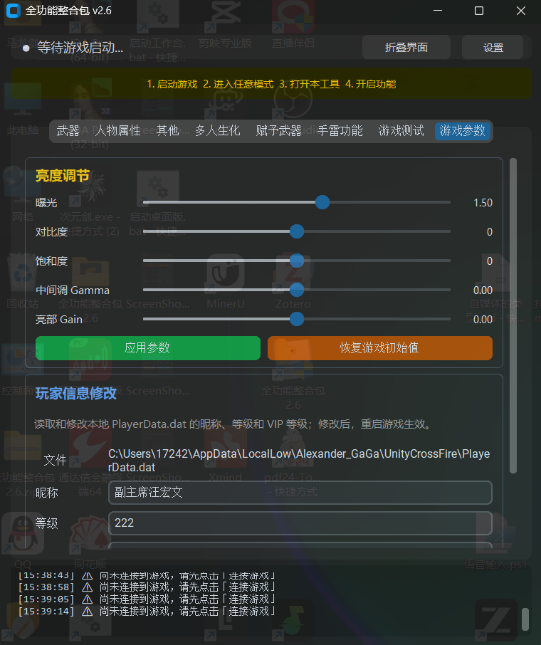
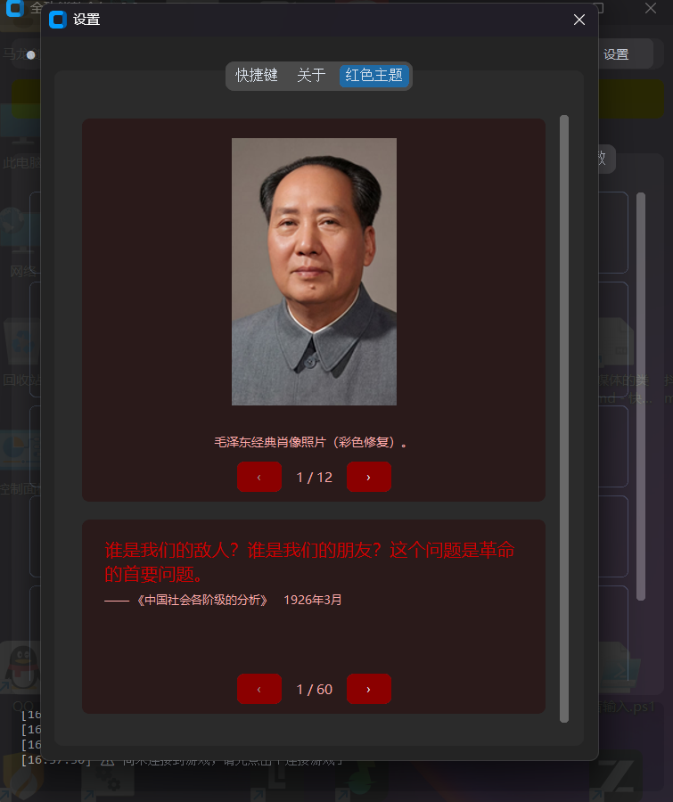
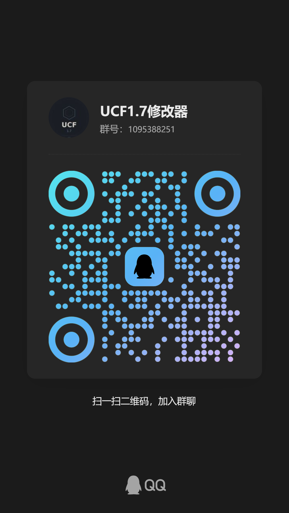

# 全功能整合包（UCF 1.7 修改器）

> **文档更新日期：2026年10月22日**
> 当前版本：**全功能整合包 v2.7**（程序内显示名以 `ui/window_contract.py` 的 `APP_VERSION` 为准）

## 这是什么

这是 **UnityCrossFire 1.7**（穿越火线单机版）的游戏修改器，正式发布形态叫 **全功能整合包**。

修改器通过 **Frida** 注入 `GameAssembly.dll`，用 JavaScript 脚本 Hook IL2CPP 方法、读写内存字段，实现 **40 项游戏功能**。界面层用 **Python + CustomTkinter** 构建，通过 RPC 与 Frida 脚本通信。

程序名、安装包名、数据目录都跟着版本号走：装好之后是 `全功能整合包2.7.exe`，设置保存在 `%LOCALAPPDATA%\UCFModifier\2.7\data`。

## 程序展示

<p align="center">
  
  &nbsp;
  
</p>

<p align="center">
  
  &nbsp;
  
</p>

<p align="center">
  
  &nbsp;
  
</p>

## 技术栈

| 层 | 技术 | 说明 |
|---|---|---|
| 注入与 Hook | Frida | Windows x86 IL2CPP，调用约定 `mscdecl` |
| 脚本逻辑 | JavaScript | Hook 方法、读写内存、定时器调度 |
| 界面 | Python + CustomTkinter | 功能面板、设置页、红色主题 Tab |
| 通信 | RPC（Frida export） | Python ↔ JS 双向调用 |
| 逆向资料 | Il2CppDumper + IDA | dump.cs 查类/字段，IDA 查汇编逻辑 |
| 打包 | PyInstaller（onedir）+ Inno Setup | 目录版产物 + 可安装 exe |

## 运行环境

- Windows **10 / 11 64 位**（Windows 7 不支持：程序基于 Python 3.12，官方已不支持 Win7）
- 运行修改器需要**管理员权限**（Frida attach + DLL 注入）
- 源码运行：Python **3.12.5** 64 位

## 如何入手了解

按以下顺序阅读，能快速理解整个项目：

```text
1. 本 README                             → 项目全貌、功能清单
2. 02-开发规范/01-项目背景与游戏信息.md      → 游戏信息、逆向资料位置、技术红线
3. 02-开发规范/00-总览与导航.md             → 开发规范文档索引、文档同步规则
4. 02-开发规范/各个功能/                    → 每个功能的设计文档（以最新整合包代码为准）
5. 04-正式发行版/全功能整合包2.7/            → 最新正式代码（当前版本）
```

> `02-开发规范/各个功能/` 里的说明统一以**最新整合包**的代码为准，不按 `05-正式功能/` 的单功能阶段代码写；单功能的开发过程记录仍留在 `05-正式功能/`。

## 项目结构

```text
ucf1.7-modifier/
├── 00-游戏逆向分析-相关信息/     # 逆向资料（dump.cs、IDA 汇编、AssetStudio）
├── 01-游戏系统分析/            # 游戏系统架构分析文档
├── 02-开发规范/                # 开发规范、功能设计文档
│   ├── 00-总览与导航.md
│   ├── 01-项目背景与游戏信息.md
│   ├── 10-单功能开发/          # 单功能开发流程、目录标准、生命周期规范
│   ├── 20-整合包接入/          # 整合包接入规范、持久化、快捷键
│   ├── 30-整合包程序与发布/     # 程序 UI 设计、打包发布、安装器规范
│   ├── 90-通用规范/            # 编码与文件规范
│   └── 各个功能/               # 40 个功能的设计文档（以最新整合包为准）
├── 03-经验手册/                # IL2CPP 逆向、Frida、git 等经验手册
├── 04-正式发行版/               # 各版本整合包源代码
│   ├── 全功能整合包1.0/ ~ 2.6/  # 历史版本
│   └── 全功能整合包2.7/         # ★ 最新稳定版
│       ├── game_modifier/      # 修改器主程序
│       │   ├── core/           # 配置、事件总线、Frida 运行时、热键管理
│       │   ├── features/       # 40 个功能插件（script.js + manifest.json + feature.py + panel.py）
│       │   ├── ui/             # 界面（主窗口、设置页、功能卡片、页签构建）
│       │   ├── packaging/      # 打包脚本（PyInstaller spec、Inno Setup 脚本）
│       │   └── main.py         # 入口
│       └── 资源/               # 图片、音效、文案、群二维码
├── 05-正式功能/                # 各功能的开发过程记录与经验总结（按单功能阶段）
└── 06-测试/                    # 临时验证脚本与截图
```

## 功能列表（40 项）

| # | 功能 | 页签 | 说明 |
|---|---|---|---|
| 1 | 无限子弹 | 武器 | 子弹永不消耗 |
| 2 | 无后座力 | 武器 | 消除枪械后座力 |
| 3 | 无限时间 | 其他 | 把局内时间设为 99:59 |
| 4 | 快刀 | 武器 | 提升挥刀速度 |
| 5 | 快速换弹 | 武器 | 换弹速度加快 |
| 6 | 滑板鞋 | 人物属性 | 提升移动速度 |
| 7 | 剑气化丝 | 武器 | 扩大近战攻击距离 |
| 8 | 聚怪 | 其他 | 把人机集中到出生点 |
| 9 | 轻重力 / 高跳 | 人物属性 | 调整重力与跳跃倍率 |
| 10 | 回合跳过 | 其他 | 结束当前回合 |
| 11 | 自瞄 | 武器 | 自动瞄准敌方玩家 |
| 12 | 金刚不坏 | 人物属性 | 角色受伤时不掉血 |
| 13 | 射速变快 / 连狙 | 武器 | 射速可调，半自动转全自动 |
| 14 | 天机傀儡 | 其他 | 让玩家由人机控制 |
| 15 | 多人生化Buff选择 | 多人生化 | 选择生化 Buff |
| 16 | 赋予武器 | 赋予武器 | 给予指定武器 |
| 17 | 技能无冷却 | 多人生化 | 生化模式技能无 CD |
| 18 | 方框透视 | 其他 | 通过 Universal DLL 显示方框透视 |
| 19 | 强制决战回合 | 多人生化 | 强制进入决战回合 |
| 20 | 时间加速 | 游戏测试 | 调整游戏时间倍率 |
| 21 | 第三人称视角 | 其他 | 切换为第三人称 |
| 22 | 无限背包 | 其他 | 远离出生点也能切换武器 |
| 23 | 极速枪托 | 武器 | 枪托重击速度更快 |
| 24 | 人机暂停 | 游戏测试 | 所有人机停止行动 |
| 25 | 自由视角 | 游戏测试 | 脱离玩家跟随，自由拖动镜头 |
| 26 | 手雷模式 | 手雷功能 | 无限手雷、人机投雷频率、爆炸伤害与范围强化（需先开无限手雷） |
| 27 | 游戏模式切换 | 其他 | 切换游戏模式（建房前应用） |
| 28 | 人体穿墙 | 其他 | 按住 Alt 穿过墙体 |
| 29 | 子弹穿墙 / 弹体穿墙 | 武器 | 子弹可穿墙；火箭筒 / 榴弹 / 手雷 / 技能弹撞墙也不被挡住 |
| 30 | 调整伤害倍率 | 武器 | 敌人 / 自己 / 队友各一条滑块，0.1x~10x |
| 31 | 定点瞬移 | 其他 | 保存点位后瞬移回点位 |
| 32 | 亮度调节 | 游戏参数 | 调整画面亮度 |
| 33 | 玩家信息修改 | 游戏参数 | 修改昵称、等级、VIP 等级 |
| 34 | 角色变身 | 多人生化 | 选择本地玩家角色；人类 / 幽灵 Bot 随机变身 |
| 35 | 全模式房间人数 | 其他 | 自定义房间人数，下一局生效 |
| 36 | 增加血量 | 人物属性 | 快捷键或按钮加血一次，上限同步提升 |
| 37 | 增加防化服 | 人物属性 | 可选仅本地玩家 / 全体人类，回合内可叠加、回合结束清零 |
| 38 | 直接变身救世主 | 多人生化 | 本地玩家或人类人机直接变救世主 |
| 39 | 直接变身剑客 | 多人生化 | 本地玩家或人类人机直接变剑客 |
| 40 | 开火直伤 / 弹体追踪 | 武器 | 子弹与投射物自动追向准星附近的敌人；可突破复活无敌 |

## 快速开始（源码运行）

1. 安装依赖（仅打包/开发需要，运行成品 exe 不需要）：
   `pip install -r 04-正式发行版/全功能整合包2.7/game_modifier/requirements-build.txt`
2. 进入程序目录运行：`python main.py`（连接游戏/注入 DLL 时建议以管理员身份启动，成品 exe 默认就会弹 UAC）
3. 启动游戏 `UnityCrossFire.exe`，进入房间
4. 在修改器界面勾选功能即可生效

## 开发者信息

- **修改器作者**：挂呱呱呱
- **代码贡献者**：少年与狗子
- **游戏原作者**：內個_shei_鸭
- **B 站主页**：[挂呱呱呱的 B 站](https://space.bilibili.com/481324794)
- **源代码**：[github.com/mlj178/UCF1.7-](https://github.com/mlj178/UCF1.7-)

## 交流与支持

<p align="center">
  
</p>

| 群 | 群号 |
|---|---|
| UCF1.7 游戏群 | 1095388251 |

## 赞赏

如果这个项目对你有帮助，可以请作者喝杯咖啡。

<p align="center">
  
</p>

## 许可

本项目仅供学习和个人娱乐使用，请勿用于商业用途或在线对战。

完整条款见程序「设置 - 免责声明」页，以及发布包内的 `免责声明.txt`（安装时同样会展示该声明）。
本项目同样**完全免费**，作者从未出售、也未授权任何第三方代售，详见程序「设置 - 免费声明」页。
